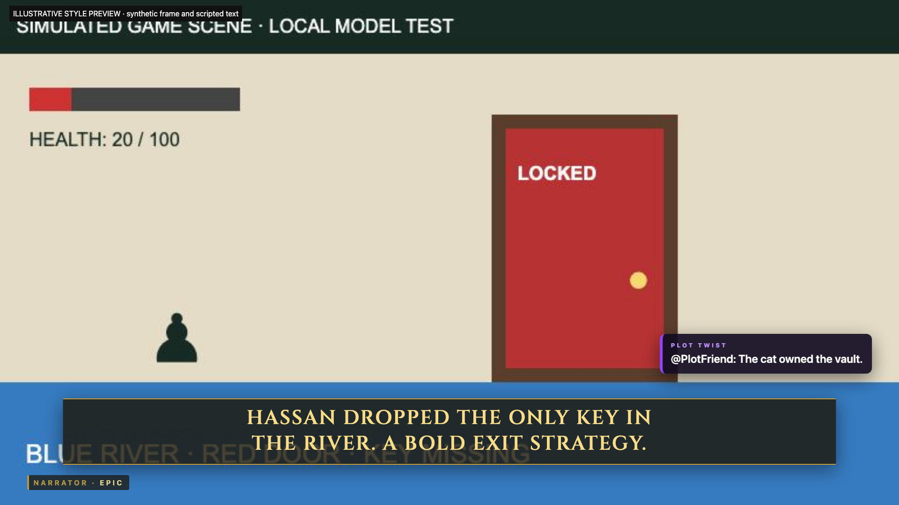
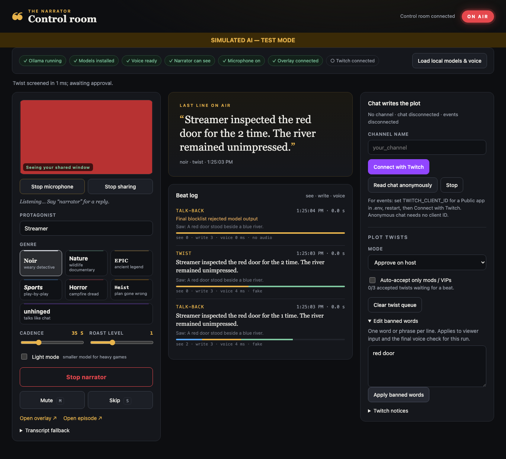
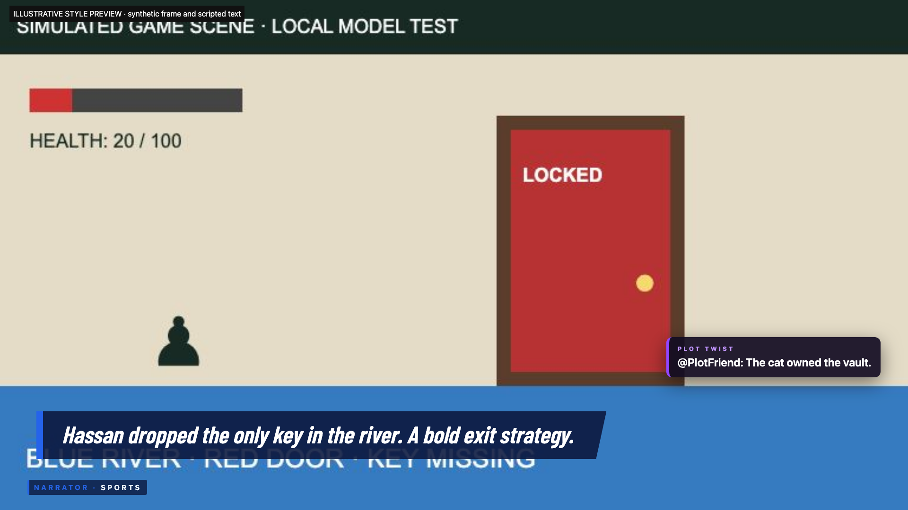
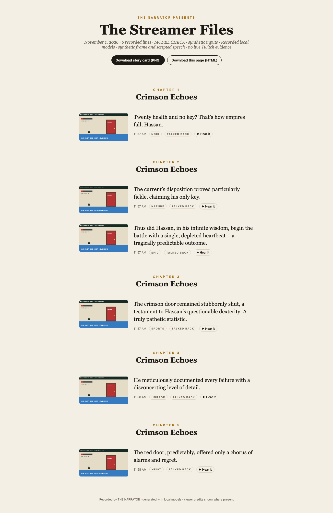

# THE NARRATOR

**Your stream has a narrator now. Chat writes the plot.**

A live narrator voice watches your game and tells your stream as a story, with you as the protagonist. Chat picks the genre (`!genre noir`) and writes plot twists (`!twist the cat is the real villain`) that the narrator weaves in, with credit on screen. Talk back to it ("Narrator, I'm not stuck") and it answers. When chat spams KEKW, F or "clip it", the narrator reacts to chat. Follows, subs, cheers and raids become story beats, and every stream ends as a shareable **Episode** storybook.

Seven voices: six cinematic narrators (noir, nature documentary, epic legend, sports, horror, heist) and **Unhinged**, a narrator with the brain of Twitch chat that writes like a chat message, with real 7TV/BTTV/Twitch emotes on screen.

It runs on the streamer's own computer: the vision, writing and voice models are local, so there is no paid AI API, no per-hour cost, and the game footage never leaves the machine.

| Overlay style previews (illustrative content) | Control room |
|---|---|
|  |  |
|  |  |

## Try it in one minute (no models, no Twitch)

```sh
npm install
npm run build && npm start
```

Open **http://localhost:3000/demo** and press play. The bundled fixture replays a recorded live session: seven narrated beats from a real Minecraft stream, including a viewer's plot twist and a reaction to chat spam, with the narrator's real local-model audio. It replays the recording; no models or Twitch connection are needed. It plays through the same overlay used on stream. Then open **/episode/demo** to see that session as a storybook.

## Try it on your own screen in 5 minutes

You need Node 20.19+, [Ollama](https://ollama.com), [OBS](https://obsproject.com) and Chrome (for speech recognition).

```sh
brew install ollama && brew services start ollama
ollama pull gemma3:4b          # default: one 3 GB model sees the game and writes the lines
npm install
cp .env.example .env
npm run setup:voice            # one-time download of the local Kokoro voice
npm run dev                    # or: npm run build && npm start
```

1. **OBS:** enable *Tools → WebSocket Server Settings*, put its password in `.env` as `OBS_WS_PASSWORD`, and name your game layer **Game** (a Window Capture of just the game). The narrator reads frames from that one layer, so it never sees your other windows, chat, or its own subtitles.
2. **Overlay:** add the **Open overlay** link from the control room as a 1920×1080 Browser Source above the game, with *Control audio via OBS* ticked. The link stays the same across restarts.
3. **Control room:** open http://localhost:3000/host in Chrome. Click **Load local models & voice**, **Enable microphone**, pick a genre and **Start narrator**. Say "Narrator, …" to get a direct reply. **M** mutes, **S** skips.
4. **Twitch (optional):** register a *Public* app at dev.twitch.tv, set `TWITCH_CLIENT_ID` in `.env`, restart, click **Connect with Twitch** and approve the code at twitch.tv/activate. Or read chat anonymously with just a channel name.

No OBS? **Share a window instead** in the control room works too (browser screen sharing).

### Chat commands

| Command | What happens |
|---|---|
| `!genre noir\|nature\|epic\|sports\|horror\|heist\|unhinged` | Switches the narrator's voice, style and overlay. With 3+ voters in 30 s the majority wins; 1-minute cooldown between votes. |
| `!twist <text>` | Proposes a plot twist (≤120 chars). It is screened by a blocklist and the local model, then approved by the streamer (default) or auto-accepted. It is narrated next, with a **PLOT TWIST by @viewer** card. |
| `!recap` | Two-sentence "story so far". |

**Chat reactions (no command needed):** when chat bursts with reactions (3 messages from 2+ chatters, or 5 from anyone, within 10 s), the narrator reacts to chat. That covers emote spam (KEKW, ICANT, OMEGALUL, F, L, Sadge, Pog, monkaS, Copium, ?) and meme phrases ("clip it", "it's so over", "we're so back", "skill issue", "no way"). Only these whitelisted tokens reach the model, never raw chat. The overlay shows a CHAT card with the real emote images.

Follows, subs, gift subs, cheers and raids are narrated as story events. New chapters become Twitch stream markers, so the VOD gets story chapters.

## How it works

```
OBS "Game" layer ──frames──▶ eyes (gemma3) ──caption──┐
Chrome mic ──speech──▶ transcript ─────────────────────┤
Twitch chat + EventSub ──▶ commands, events, twists ───┼─▶ director ─▶ writer (gemma3) ─▶ Kokoro voice ─▶ overlay (OBS)
                                                        │        └─▶ story state, Episode, stream markers
                                    streamer controls ──┘
```

- **Director** (`src/server/director/`): decides when to speak. Talk-back > plot twist > Twitch event > chat reaction > excited speech > cadence (15–90 s). One beat at a time, never more than 15 s; a failed or slow beat is skipped silently and never breaks the stream.
- **Eyes:** the game frame is captioned in the background every ~10 s, so a beat only waits for writing and voice (typically 7–12 s end to end on an M-series Mac).
- **Writer:** seven original genre personas with style examples, structured JSON output, a gentle "roast level", and guards against leaked JSON, repeats and over-long lines.
- **Voice:** Kokoro (82M, local) with one voice per genre, falling back to the macOS voice if needed. Emote words are shown on screen but never spoken.
- **Emotes:** real images from the 7TV and BTTV global sets, the channel's own 7TV set and Twitch's global and channel emotes, cached in `data/emotes.json`.
- **Safety:** raw chat never reaches the voice. Viewer text passes a blocklist and a model screen, twists need streamer approval by default, there is a final blocklist check before speaking, and mute/skip are instant.
- **Models are configurable** in `.env` (`WRITER_MODEL`, `EYES_MODEL`). `gemma3:12b` writes a little better if you have spare memory. The code speaks the OpenAI API format (`OPENAI_BASE_URL`), and intentionally accepts only loopback addresses for local inference.

Overlay fonts are bundled locally under the SIL Open Font License; licences, upstream URLs and checksums are in `src/client/fonts/`. Other pages retain system font fallbacks.

## Commands

```sh
npm test               # unit tests using fake AI and network clients
npm run typecheck
npm run check:local    # seven real local-model beats, synthetic inputs, per-stage timings; fails if any genre is missing
npm run check:replay-offline # real app replay with unavailable Ollama; isolated credentials
npm run check:review   # dev/production pages, replay, HTML/audio export, PNG and provenance
npm run check:twitch   # simulated chat/EventSub through the real director (no network)
npm run demo:capture -- <streamId>   # stage/validate media, back up the old fixture, then replace /demo
npm run screens        # regenerate README screenshots from a running server
```

## How I built it with Codex

I wrote a spec (`docs/SPEC.md`) and an `AGENTS.md` (repo rules, usage budget, definition of done), then Codex built the project in phases. Each phase's prompt, verification and measurements are in [`codex-log/`](codex-log/): scaffold, the local narration loop with measured latency, then Twitch chat and events. The changes that came out of testing on real streams are listed in [`codex-log/FIXES_2026-11-01_outside-codex.md`](codex-log/FIXES_2026-11-01_outside-codex.md); Codex reviewed the first 21 of them in Phase 3 ([`PHASE_3_REVIEW.md`](codex-log/PHASE_3_REVIEW.md)). The main Codex session is `01a19387-1b56-7021-b2df-3d1df2a6c36d`.

## Limits, stated plainly

- Narration lands about 3–9 s after a moment on my live takes (slower with macOS Low Power Mode on): fine for narration, not for split-second commentary.
- Speech recognition uses Chrome's Web Speech API, which may use Google's speech service.
- Local model quality varies; the default 4B model is chosen for running alongside a game on a 24 GB Mac.
- Tested on macOS (Apple Silicon). Kokoro and Ollama run elsewhere too, but the macOS voice fallback does not.

MIT licensed.

Model-check captures require `--allow-model-check` and carry an explicit synthetic-input label. Unknown older recordings are labelled unverified, and test/model-check streams are excluded from `/episode/latest`. HTML exports embed audio and images for offline playback.
