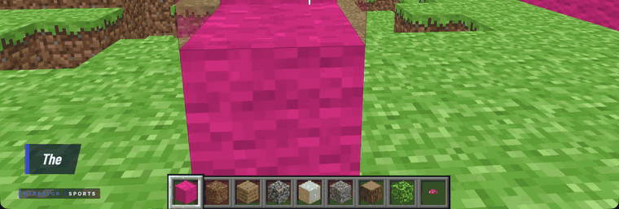
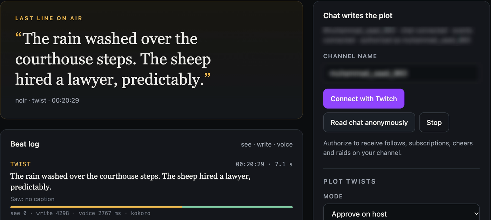
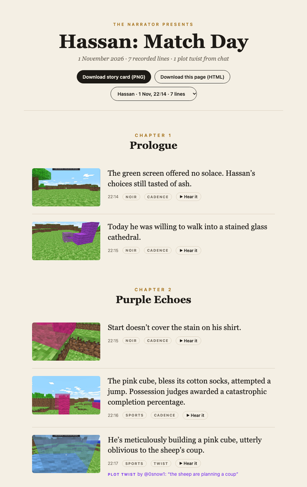
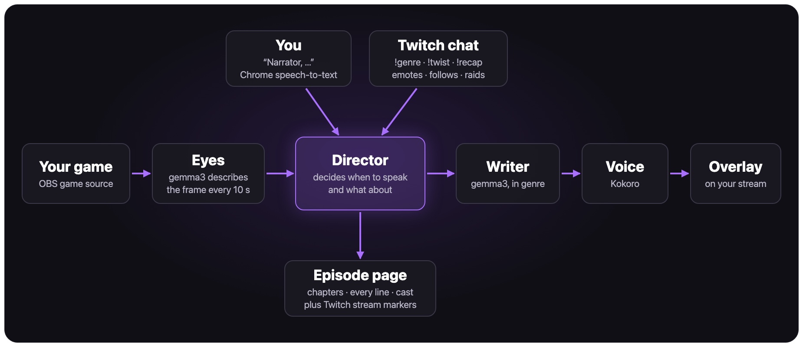

# The Narrator

A live narrator for your Twitch stream. It watches your game, listens to you, and tells the stream as a story, out loud, while you play. Your chat changes the genre and writes plot twists.

<p align="center">
  
</p>
<p align="center"><sub>From a live test stream in sports mode. The line was written and spoken by the app as it happened.</sub></p>

I made this for the Codex × TwitchCon hackathon. Most streams on Twitch have a handful of viewers, and when I stream it's mostly me talking to an empty chat. I wanted something that makes a quiet stream feel like a show, and gives the one or two people watching a way to mess with it.

## What it does

- **Narrates your stream.** Every 15 to 90 seconds (you set it), it looks at the game, writes a line in the current genre and says it over your stream, with subtitles. There are seven genres: noir, nature documentary, epic, sports, horror, heist, and unhinged, which talks like Twitch chat.
- **Answers you.** Say "Narrator, …" on mic and it replies to what you said.
- **Lets chat write the plot.** `!genre sports` changes the voice and style. `!twist the sheep are planning a coup` gets worked into the next line, with the viewer's name on screen. `!recap` gives the story so far.
- **Reacts to chat.** When chat spams KEKW, F, Pog or "clip it", it comments on that.
- **Turns Twitch events into story.** Follows, subs, cheers and raids get narrated, and each new chapter is added as a stream marker.
- **Keeps an episode page.** Every stream is saved with chapters, every line (you can replay each one) and a cast list of the viewers who wrote twists. You can download it as a PNG card or an HTML page.

All the AI runs on your own computer. Ollama runs the model that sees the game and writes the lines (gemma3:4b by default), and Kokoro does the voice. There's no API bill, and your game footage never leaves your machine.

<table>
  <tr>
    <td width="62%" valign="top"></td>
    <td width="38%" valign="top"></td>
  </tr>
  <tr>
    <td><sub>The control room. A viewer's twist, approved here, was on air 7.1 s later.</sub></td>
    <td><sub>Part of the episode page for the stream in the GIF. The last line calls back the cathedral from two minutes earlier.</sub></td>
  </tr>
</table>

## Try the demo (no models, no Twitch)

```sh
npm install
npm run build && npm start
```

Open http://localhost:3000/demo and press play. It replays a real recorded stream through the same overlay you'd add to OBS, with the narrator's original audio. Then open http://localhost:3000/episode/demo to see that stream's episode page.

## Use it on your own stream

You need Node 20.19 or newer, [Ollama](https://ollama.com), [OBS](https://obsproject.com) and Chrome (for speech recognition). Setup takes about five minutes.

```sh
brew install ollama && brew services start ollama
ollama pull gemma3:4b      # about 3 GB; sees the game and writes the lines
npm install
cp .env.example .env
npm run setup:voice        # downloads the Kokoro voice once
npm run dev
```

1. In OBS, turn on *Tools → WebSocket Server Settings* and put the password in `.env` as `OBS_WS_PASSWORD`. Name your game capture source **Game**. The narrator only reads that source, so it never sees your other windows, your chat or its own subtitles.
2. In the control room, copy the overlay link and add it to OBS as a 1920×1080 Browser Source above the game, with *Control audio via OBS* ticked.
3. Open http://localhost:3000/host in Chrome. Click **Load local models & voice**, then **Enable microphone**, pick a genre and press **Start narrator**. **M** mutes and **S** skips.
4. For Twitch, register a *Public* app at dev.twitch.tv, set `TWITCH_CLIENT_ID` in `.env`, restart and click **Connect with Twitch**. You can also read chat anonymously with just a channel name.

After that, starting a recording in OBS starts a new episode. No OBS? Click **Share a window instead** in the control room.

## Chat commands

| Command | What it does |
|---|---|
| `!genre` | `!genre sports` switches the narrator's voice and style. The options are `noir`, `nature`, `epic`, `sports`, `horror`, `heist` and `unhinged`. If 3 or more people vote within 30 s, the majority wins, and there's a one-minute cooldown. |
| `!twist` | `!twist the sheep are planning a coup` suggests a plot twist (up to 120 characters). A blocklist and the local model check it, then you approve it in the control room, or switch on auto-accept. It goes into the next line with a **PLOT TWIST by @viewer** card. |
| `!recap` | Two short sentences on the story so far. |

Chat reactions don't need a command. If chat bursts with emotes or memes (3 messages from 2 or more people, or 5 from anyone, within 10 s), the narrator reacts. It knows KEKW, ICANT, OMEGALUL, F, L, Sadge, Pog, monkaS, Copium and "?", plus phrases like "clip it", "it's so over", "we're so back", "skill issue" and "no way". Only those tokens reach the model, never the chat messages themselves.

## How it works

<p align="center"></p>

- The **director** (`src/server/director/`) decides when to speak. You talking to it comes first, then plot twists, Twitch events, chat reactions, you getting excited, and finally the timer. It says one line at a time. If a line fails or takes more than 30 s, it's dropped, so the stream never stalls.
- The **eyes** describe the game in the background every 10 s, so a line only waits on writing and voice. On my M5 MacBook a line usually lands 4 to 10 s after the moment.
- The **writer** has a persona and example lines for each genre, a roast level you can turn up, and checks for repeated lines, stray JSON and lines that run too long.
- The **voice** is Kokoro (82M parameters, runs locally), with one voice per genre and the macOS voice as a fallback. Emote names appear on screen but are never read out.
- **Safety:** chat text never goes straight to the voice. Anything a viewer writes passes a blocklist and a model check, twists need your approval by default, there's one more blocklist check right before speaking, and mute and skip work instantly.
- You can change the models in `.env` (`WRITER_MODEL`, `EYES_MODEL`). `gemma3:12b` writes a bit better if you have the memory. The client uses the OpenAI API format but only accepts local addresses, on purpose.

## How I built it with Codex

I wrote the spec ([`docs/SPEC.md`](docs/SPEC.md)) and an [`AGENTS.md`](AGENTS.md) with the repo rules, my usage budget and what counts as done. Then I gave Codex one phase at a time ([`PROMPTS.md`](PROMPTS.md)). Phases 0 to 2 ran in a single Codex thread between about 1 and 3 a.m. on 1 November: the scaffold, the local narration loop with per-stage latency measured, then Twitch chat, EventSub and twist moderation. Codex ran the tests as it went: 39 runs in the log, going from 1 test to 75 by the end of the review. Its notes and measurements for each phase are in [`codex-log/`](codex-log/).

Then I took it onto real Twitch streams, and that's where most of the problems showed up. Speech-to-text heard "Narrator" as "Nader", the model said it had used a twist when it hadn't, and the vision model read its own subtitles. Every fix I made outside Codex is listed in [`codex-log/FIXES_2026-11-01_outside-codex.md`](codex-log/FIXES_2026-11-01_outside-codex.md). Codex reviewed the first 21 of them in Phase 3 ([`PHASE_3_REVIEW.md`](codex-log/PHASE_3_REVIEW.md)).

Codex session: `01a19387-1b56-7021-b2df-3d1df2a6c36d`

## Known issues

- Lines land 4 to 10 s after the moment, slower in macOS Low Power Mode. That's fine for narration but too slow for fast games.
- The 4B model sometimes writes nonsense. My favourite from a live stream: "The KEKW response speaks volumes – a sheep respect, clip needed."
- Speech recognition uses Chrome's Web Speech API, which may send your audio to Google.
- I've only tested it on macOS (Apple Silicon, 24 GB RAM). Ollama and Kokoro run on other systems, but the macOS voice fallback doesn't.

## Development

```sh
npm test                       # unit tests with fake AI and network clients
npm run typecheck
npm run check:local            # one real local-model line per genre, with timings
npm run check:replay-offline   # the replay with Ollama unavailable
npm run check:review           # pages, replay, HTML and audio export, PNG card
npm run check:twitch           # simulated chat and EventSub through the real director
npm run demo:capture -- <streamId>   # make a recorded stream the /demo replay
```

The overlay fonts are bundled under the SIL Open Font License; see `src/client/fonts/`. The project is MIT licensed.
